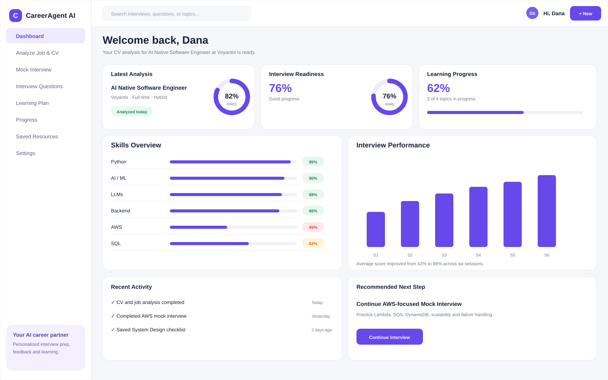
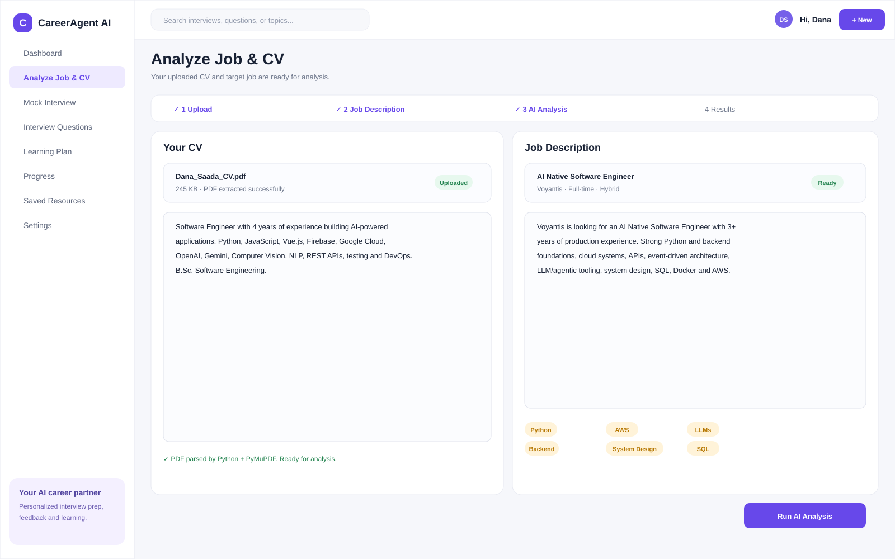
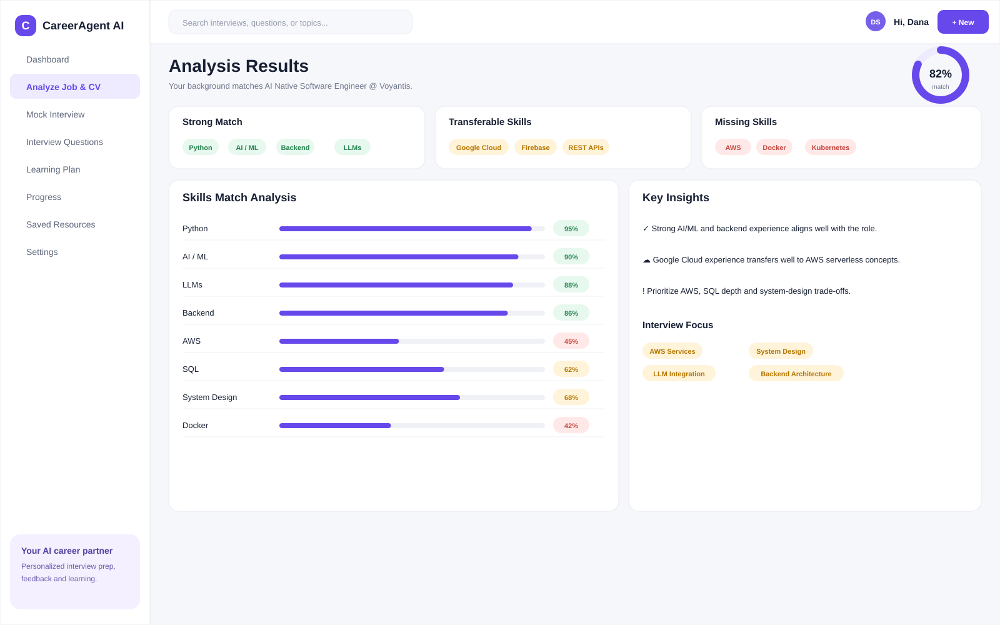
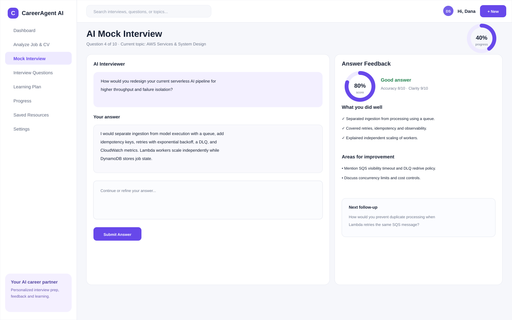
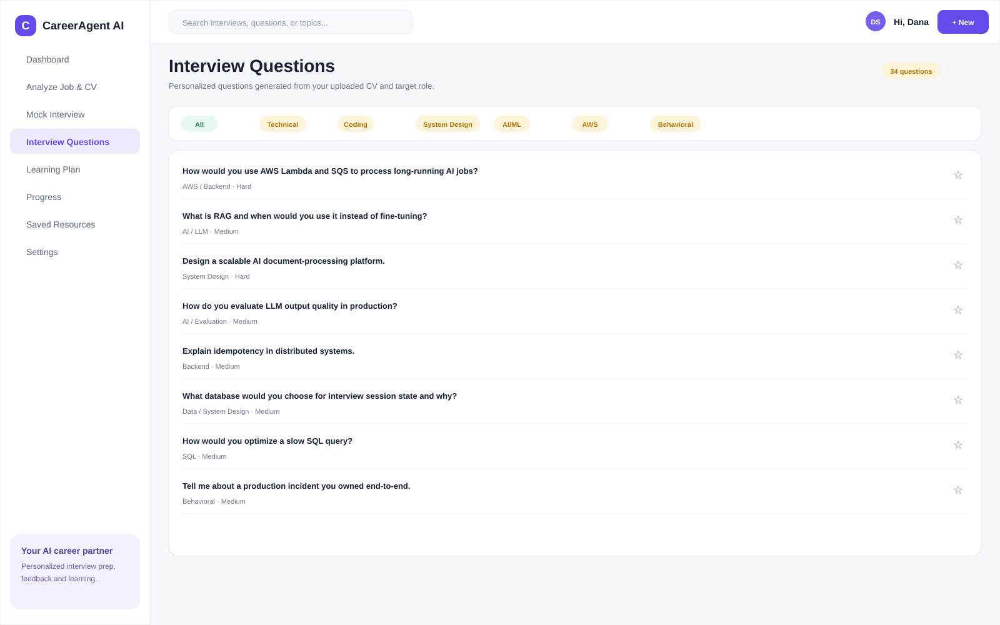
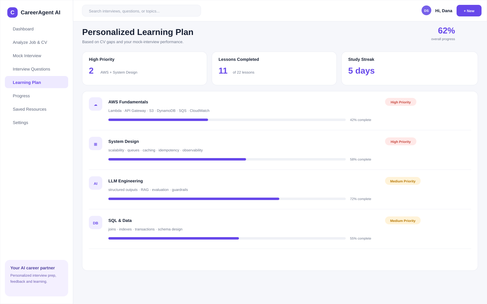
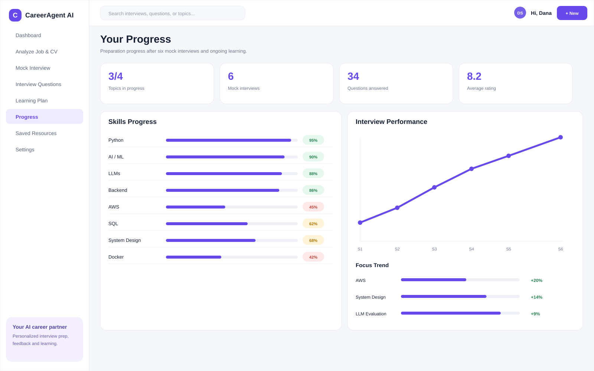
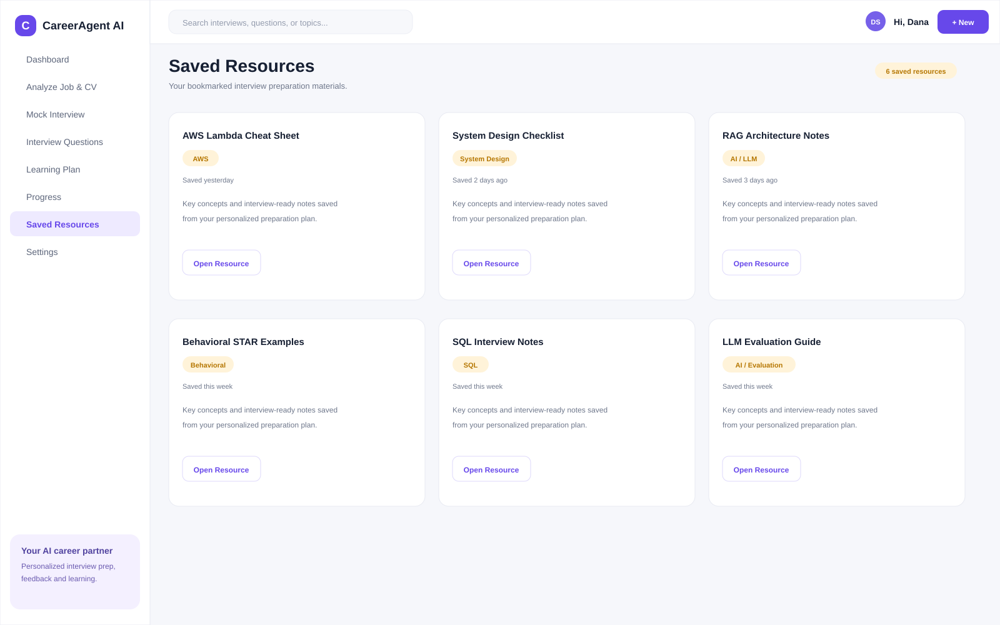
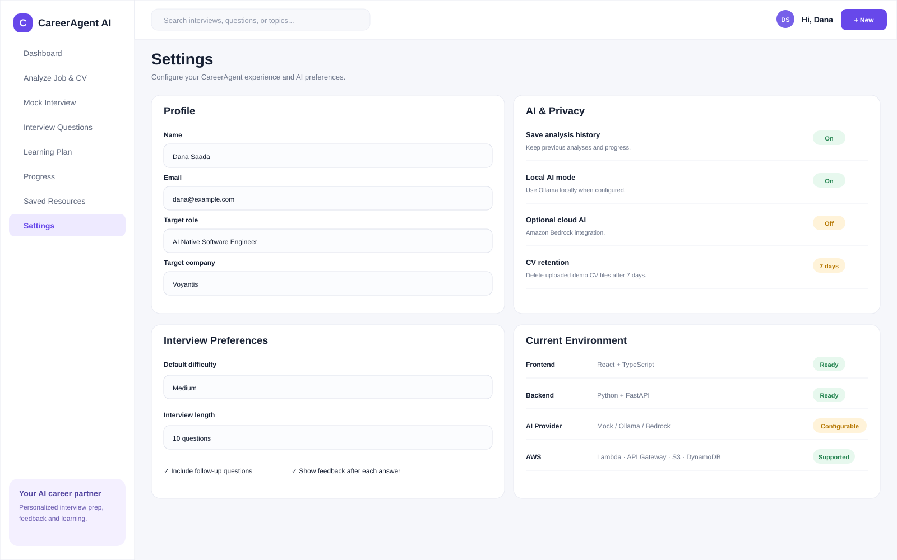

# CareerAgent AI — Python + AWS Edition

AI-native interview preparation platform. The frontend is React + TypeScript; the backend and AI orchestration are Python.

## UI screenshots — final state after CV upload and analysis

The screenshots below show a **populated demo scenario after a CV was uploaded, a target job was added, and the analysis was completed**. This is the state a recruiter sees in the README instead of empty first-run screens.

Sample scenario used in the UI:

- Candidate: software engineer with Python, AI/ML, LLM, JavaScript/Vue, Firebase and Google Cloud experience
- Target role: **AI Native Software Engineer**
- Company: **Nexora Labs**
- Match score: **82%**
- Interview readiness: **76%**
- Main preparation gaps: AWS, Docker, SQL depth and system design

### 1. Dashboard

The final dashboard contains match/readiness rings, learning progress, a skills chart, interview-performance history, recent activity and the next recommended action.



### 2. Analyze Job & CV

The CV is shown as already uploaded and extracted by the Python/PyMuPDF backend. The job description is populated and ready to analyze.



### 3. Analysis Results

The results page shows strong, transferable and missing skills, detailed skill bars and interview focus areas.



### 4. AI Mock Interview

The screenshot shows an interview already in progress, including a candidate answer, AI score, strengths, improvement areas and a generated follow-up question.



### 5. Interview Questions

The question library is populated with technical, AWS, AI/LLM, system-design, SQL and behavioral questions generated for the target role.



### 6. Personalized Learning Plan

The learning plan contains real preparation topics, priorities and progress bars for AWS, system design, LLM engineering and SQL/data.



### 7. Progress

The progress screen contains all current charts: skill progress, interview-performance history, topic improvement trends and summary KPIs.



### 8. Saved Resources

The final state contains saved resources for AWS, system design, RAG, SQL, LLM evaluation and behavioral interviews.



### 9. Settings

The settings view contains profile data, interview preferences, privacy/AI options and the current React/Python/AWS environment.



> The screenshots use sample portfolio data so the repository demonstrates the complete product experience. Real users get their own values after uploading a CV and running an analysis.

## What the system does

1. Upload a CV PDF or paste CV text.
2. Paste a target job description.
3. Analyze matching skills, missing skills, transferable experience, interview focus areas and a learning plan.
4. Run an adaptive mock interview with answer evaluation and dynamic follow-up questions.
5. Track readiness, questions and learning progress in the UI.

## Tech stack

### Frontend
- React 19
- TypeScript
- Vite
- Lucide icons

### Python backend
- Python 3.12
- FastAPI
- Pydantic
- Mangum (FastAPI -> AWS Lambda)
- boto3 (AWS SDK)
- PyMuPDF (PDF CV text extraction)
- httpx (Ollama HTTP client)

### AWS
- API Gateway HTTP API
- AWS Lambda (Python 3.12)
- DynamoDB
- S3
- CloudWatch Logs
- IAM
- Amazon Bedrock (optional)
- AWS SAM

## Architecture

```text
React + TypeScript
        |
        v
API Gateway HTTP API
        |
        v
AWS Lambda - Python 3.12
FastAPI + Mangum
   |          |             |
   v          v             v
DynamoDB      S3       AI provider
                         |-- mock (free demo)
                         |-- Ollama (local model)
                         `-- Bedrock (optional cloud AI)
```

### Where Python is used

Python is responsible for:
- FastAPI REST endpoints
- CV PDF extraction with PyMuPDF
- CV/job skill analysis
- AI prompt orchestration
- structured Pydantic outputs
- mock interview answer evaluation
- dynamic follow-up questions
- DynamoDB persistence through boto3
- S3 CV storage through boto3
- Bedrock integration

## Project structure

```text
careeragent-ai/
├── backend/
│   ├── app.py               # FastAPI + Lambda handler
│   ├── ai.py                # Ollama / Bedrock / mock provider
│   ├── analysis_engine.py   # deterministic fallback analysis
│   ├── models.py            # Pydantic schemas
│   ├── pdf_service.py       # PyMuPDF + optional S3 storage
│   ├── store.py             # DynamoDB / in-memory store
│   ├── requirements.txt
│   ├── run_local.py
│   └── test_smoke.py
├── frontend/
│   └── src/                 # React + TypeScript UI
├── infra/
│   └── template.yaml        # AWS SAM stack
├── sample-data/
├── scripts/
├── docs/
│   └── screenshots/          # screenshots captured from the application UI
└── FREE_TIER.md
```

## Run locally

### 1. Backend

Requirements: Python 3.11+ (3.12 recommended).

```bash
cd backend
python -m venv .venv
source .venv/bin/activate        # Windows: .venv\\Scripts\\activate
pip install -r requirements.txt
cp .env.example .env
python -m uvicorn app:app --reload --port 8000
```

Backend URL:

```text
http://localhost:8000
```

Health check:

```text
http://localhost:8000/health
```

Interactive FastAPI docs:

```text
http://localhost:8000/docs
```

### 2. Frontend

In another terminal:

```bash
cd frontend
npm install
cp .env.example .env
npm run dev
```

Open:

```text
http://localhost:5173
```

## Free AI mode

The default is:

```env
AI_PROVIDER=mock
```

This makes the full application usable without an AI API bill. It uses the Python deterministic analysis engine and mock interview evaluation.

### Real local AI with Ollama

Install Ollama and pull a small model, for example:

```bash
ollama pull llama3.2:3b
```

Then set `backend/.env`:

```env
AI_PROVIDER=ollama
OLLAMA_URL=http://127.0.0.1:11434
OLLAMA_MODEL=llama3.2:3b
```

Ollama is used locally; do not set `AI_PROVIDER=ollama` inside AWS Lambda unless you separately host an Ollama endpoint reachable from AWS.

## Optional Amazon Bedrock

Set:

```env
AI_PROVIDER=bedrock
BEDROCK_MODEL_ID=amazon.nova-lite-v1:0
```

For AWS deployment choose `bedrock` when SAM asks for the `AiProvider` parameter.

Bedrock is optional and can create AWS usage charges. The zero-cost-first demo should stay on `mock`, or use Ollama locally.

## CV PDF upload flow

The Analyze page supports PDF upload:

```text
CV.pdf
  |
  v
React converts file to base64
  |
  v
POST /cv/extract
  |
  v
Python + PyMuPDF
  |
  +--> extracted text returned to UI
  |
  `--> private S3 storage when CV_BUCKET exists
```

The demo limits PDFs to 5 MB and the AWS S3 bucket has a 7-day lifecycle rule.

## AWS deployment

Requirements:
- AWS CLI configured
- AWS SAM CLI
- Docker (commonly required by SAM build depending on environment)

Deploy:

```bash
./scripts/deploy-aws.sh
```

Or manually:

```bash
cd infra
sam build
sam deploy --guided
```

For a no-model-cost AWS demo, keep:

```text
AiProvider = mock
```

SAM creates:
- Python Lambda
- HTTP API Gateway
- DynamoDB table
- private S3 bucket
- IAM permissions
- CloudWatch logging through Lambda

After deployment copy the `ApiUrl` output into `frontend/.env`:

```env
VITE_API_URL=https://YOUR_API_ID.execute-api.YOUR_REGION.amazonaws.com
```

Then build the UI:

```bash
cd frontend
npm install
npm run build
```

## API endpoints

| Method | Endpoint | Purpose |
|---|---|---|
| GET | `/health` | backend status and active AI provider |
| POST | `/cv/extract` | extract text from PDF using Python |
| POST | `/analyze` | CV + job match analysis |
| GET | `/analysis/{id}` | retrieve stored analysis |
| POST | `/interview/evaluate` | evaluate answer and produce follow-up |

## Tests

Python syntax check:

```bash
python -m compileall backend
```

After installing Python dependencies:

```bash
cd backend
python -m pytest test_smoke.py
```

API smoke test while backend is running:

```bash
./scripts/smoke-test.sh
```

## Good interview talking points

- Why React stays TypeScript while AI/backend services use Python.
- FastAPI on Lambda through Mangum.
- Pydantic structured outputs around LLM responses.
- Provider abstraction: deterministic mock, local Ollama, optional Bedrock.
- Why S3 is private and has a short lifecycle for uploaded CVs.
- DynamoDB for serverless analysis state.
- Transferable cloud knowledge from Firebase/GCP to AWS.
- Production extensions: Cognito, presigned S3 uploads, SQS async jobs, DLQ, idempotency, Bedrock Guardrails and structured CloudWatch metrics.

## Important AWS cost note

The project is designed to be inexpensive and defaults to a model-free `mock` provider. AWS pricing/free offers depend on account type, region and current AWS terms, so no deployed cloud architecture can guarantee a $0 bill. Use AWS Budgets/Billing alerts, keep Bedrock disabled unless needed, and delete the stack after demos.

To remove the AWS stack, run:

```bash
./scripts/destroy-aws.sh
```


## Real-data behavior in this build

The frontend no longer falls back to demo statistics when the API fails. It starts empty, uploads PDFs to the Python `/cv/extract` endpoint, and only shows analysis statistics after a successful `/analyze` response. For local development the frontend is configured to call `http://localhost:8000`.

## UI Preview

### Application overview

The following overview shows the main CareerAgent AI screens, including authentication, dashboard, CV/job analysis, mock interview, interview feedback, question library, learning plan and progress tracking.


### Dashboard

The dashboard summarizes the latest CV/job analysis, interview readiness, skill matches, missing skills and recommended next actions.


## Real end-to-end example

This repository includes a reproducible sample in `sample-data/cv.txt` and `sample-data/job.txt`. The values below are produced by the Python deterministic analysis engine in `backend/analysis_engine.py`; they are not hand-written README scores.

### Example CV input

```text
Software Engineer with experience building AI-powered applications using JavaScript,
Vue.js, Python, Firebase and Google Cloud. Integrated OpenAI and Gemini APIs,
computer vision and NLP workflows. Worked across frontend and backend development,
APIs, image/text processing, testing and DevOps. B.Sc. in Software Engineering.
```

### Example target job

```text
Nexora Labs - AI Native Software Engineer
Build AI-native products and backend systems. Strong Python, cloud and API development.
Experience with LLMs, system design and production software. AWS, SQL, Docker, RAG
and scalable backend architecture are valuable.
```

### Actual Python analysis output

| Metric | Result |
|---|---:|
| Overall match | **55%** |
| Interview readiness | **52%** |
| Strong skills | Python, LLM |
| Transferable skill | AWS (from Google Cloud / Firebase experience) |
| Missing skills | SQL, Docker, System Design, RAG |

#### Skill scores produced by the engine

| Skill | Score | Classification |
|---|---:|---|
| Python | 92% | Strong |
| AWS | 62% | Transferable / Partial |
| SQL | 35% | Missing |
| Docker | 35% | Missing |
| System Design | 35% | Missing |
| LLM | 92% | Strong |
| RAG | 35% | Missing |

The same analysis also creates these interview-focus areas: **AI/LLM Integration, System Design, Backend Architecture, SQL and Docker**. It generates a learning plan covering **AWS Fundamentals, System Design, LLM Engineering and SQL & Data**.

> Reproduce it locally by running the backend with `AI_PROVIDER=mock` and analyzing the files under `sample-data/`. The mock provider is deterministic, so it is useful for demos and testing without an external AI bill.

## Charts and visual analytics

CareerAgent AI uses visual indicators throughout the product. The screenshots in this repository show the charts in the real application UI.

### Dashboard — match and readiness rings + learning progress

The dashboard contains circular indicators for the overall job match and interview readiness, plus the learning-plan progress bar.


### Analysis Results — overall match ring + per-skill bars

The results view combines the overall match ring with individual skill bars and classifications, making it easy to see strong, transferable and missing skills.


### Mock Interview — session progress + answer score

During an interview, the UI displays interview progress. After an answer is evaluated, it also displays the answer score together with technical-accuracy and clarity feedback.


### Learning Plan — progress bars by learning topic

Each learning-plan topic has its own progress bar and priority level.


### Progress — skill bars + interview-performance chart

The Progress page contains skill-progress bars and the interview-performance history chart, in addition to summary metrics for completed topics, mock interviews, answered questions and average rating.


### Visualizations currently implemented

- Overall job-match circular progress
- Interview-readiness circular progress
- Learning-plan progress bar
- Per-skill match bars
- Mock-interview session progress ring
- Interview-answer score ring
- Learning-topic progress bars
- Skills-progress bars
- Interview-performance history chart

